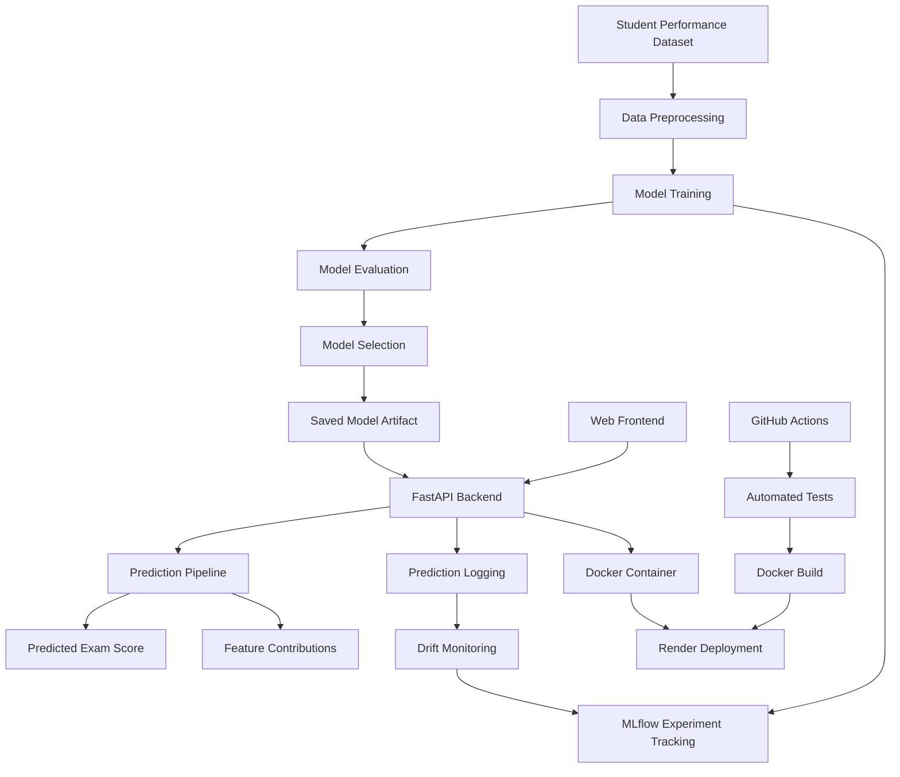

# StudentPerformanceMLOps

An end-to-end Machine Learning Operations (MLOps) project that predicts student examination performance using regression models, with experiment tracking, model explainability, data drift monitoring, API deployment, Docker containerization and automated CI/CD.

**Live Application:** https://studentperformancemlops-7ojq.onrender.com

**API Documentation:** https://studentperformancemlops-7ojq.onrender.com/docs

---

## 1. Project Overview

StudentPerformanceMLOps is an end-to-end machine learning application designed to predict students' examination scores based on academic, personal, family and lifestyle-related factors.

The project demonstrates the complete ML lifecycle, from data preprocessing and model training to experiment tracking, model deployment, prediction explainability and monitoring.

The application provides an interactive web interface where users can enter student information and receive:
- Predicted examination scores.
- Personalized performance recommendations.
- Feature contribution explanations showing which inputs influenced the prediction.

The project integrates MLOps practices to make the machine learning workflow reproducible, trackable and deployable.

## 2. Problem Statement

Student performance is influenced by multiple factors, including study hours, attendance, previous academic performance, sleep, tutoring and environmental conditions.

The objective of this project is to develop a regression-based machine learning system that estimates examination scores using these factors and provides interpretable predictions.

## 3. Key Features

- **Machine Learning:** Comparison of Linear Regression and Random Forest regression models.
- **Automated Preprocessing:** Numerical imputation, feature scaling and categorical encoding.
- **Experiment Tracking:** MLflow-based experiment and metric tracking.
- **Model Explainability:** Feature contribution analysis using Linear Regression coefficients.
- **Data Drift Monitoring:** Statistical monitoring of incoming prediction data against training statistics.
- **REST API:** FastAPI-powered prediction endpoint.
- **Interactive Frontend:** Responsive web interface for submitting student information and viewing predictions.
- **Containerization:** Docker-based application packaging.
- **Automated Testing:** Pytest-based API testing.
- **CI/CD:** GitHub Actions workflow for testing, Docker image building and Render deployment.

## 4. Technology Stack

| Category | Technologies |
|---|---|
| Programming Language | Python |
| Data Processing | Pandas, NumPy |
| Machine Learning | Scikit-learn |
| Model Persistence | Joblib |
| Experiment Tracking | MLflow |
| Backend | FastAPI |
| API Server | Uvicorn |
| Frontend | HTML, CSS, JavaScript |
| Testing | Pytest, HTTPX |
| Containerization | Docker |
| CI/CD | GitHub Actions |
| Deployment | Render |
| Database for MLflow Tracking | SQLite |

## 5. Dataset

**Dataset:** `Student Performance Factors.csv`

The dataset contains student-related academic, demographic, family and lifestyle attributes used to predict examination scores.

**Target Variable:** `Exam_Score`

The remaining columns are used as input features.

The dataset is stored in the `data/` directory.

## 6. Machine Learning Pipeline

### Data Preprocessing

The preprocessing workflow uses Scikit-learn pipelines and a ColumnTransformer.

**Numerical Features**
- Missing values are handled using median imputation.
- Features are standardized using StandardScaler.

**Categorical Features**
- Missing values are handled using most-frequent imputation.
- Categorical variables are transformed using OneHotEncoder.
- Unknown categories are handled using `handle_unknown="ignore"`.

### Model Training

Three regression models are evaluated:

1. Linear Regression
2. Random Forest Regressor with 100 estimators
3. Random Forest Regressor with 200 estimators

The dataset is divided into training and testing sets using an 80:20 split with `random_state=42`.

### Model Evaluation

The models are evaluated using:

| Metric | Purpose |
|---|---|
| MAE | Measures average absolute prediction error |
| MSE | Measures average squared prediction error |
| RMSE | Measures prediction error in the target's original units |
| R² Score | Measures the proportion of target variance explained by the model |

The model with the highest test-set R² score is selected and saved using Joblib.

### Selected Model

The deployed model is Linear Regression.

Previously recorded evaluation results:

| Metric | Value |
|---|---:|
| MAE | 0.4524 |
| MSE | 3.2560 |
| RMSE | 1.8044 |
| R² Score | 0.7696 |

These are the recorded evaluation results for the selected model.

## 7. Experiment Tracking with MLflow

MLflow is integrated into the training pipeline to track machine learning experiments.

The implementation records:
- Model names.
- Evaluation metrics.
- Trained model artifacts.
- Experiment runs.

The experiment is named:

`Student Performance Prediction`

The local MLflow tracking backend uses SQLite:

`sqlite:///mlflow.db`

To launch the MLflow UI locally:

```bash
mlflow ui
```

Open:

`http://127.0.0.1:5000`

## 8. Model Explainability (XAI)

The application includes a feature contribution explanation mechanism based on the coefficients of the deployed Linear Regression model.

For each prediction, the input is transformed using the fitted preprocessing pipeline.

Feature contributions are calculated as:

**Contribution = Transformed Feature Value × Regression Coefficient**

The application:
- Calculates individual feature contributions.
- Sorts contributions by absolute magnitude.
- Returns the top eight contributions.
- Displays positive and negative contributions in the frontend.

Positive contributions increase the model's prediction relative to its transformed baseline, while negative contributions decrease it.

These contributions describe model behaviour and should not be interpreted as causal effects.

## 9. Data Drift Monitoring

The project includes a statistical drift monitoring mechanism implemented in `drift_check.py`.

### Monitoring Workflow

1. Training statistics are generated and stored in `model/training_stats.json`.
2. Incoming prediction inputs are recorded in `prediction_logs.csv`.
3. Current feature statistics are compared against training statistics.
4. Mean and standard deviation deviations are evaluated.
5. Monitoring results are logged to MLflow.

**Drift Threshold:** 20%

Drift is flagged when either the current feature mean or standard deviation differs from its corresponding training statistic by more than 20%.

A minimum of 10 non-null observations is required for a feature to be evaluated.

This implementation monitors statistical feature distribution changes. It does not directly measure concept drift or model performance degradation.

To execute drift monitoring:

```bash
python drift_check.py
```

## 10. Project Architecture



## 11. API Endpoints

The application uses FastAPI to expose prediction and health-check endpoints.

| Endpoint | Method | Description |
|---|---|---|
| `/` | GET | Serves the frontend |
| `/health` | GET | Checks application health |
| `/predict` | POST | Generates an examination score prediction |
| `/docs` | GET | Interactive Swagger API documentation |

### Prediction Response

The `/predict` endpoint returns:

- `predicted_exam_score`: Predicted examination score.
- `tip`: Performance recommendation based on the predicted score.
- `explanations`: Top eight feature contributions.

## 12. Project Structure

```text
StudentPerformanceMLOps/
│
├── data/
│   └── Student Performance Factors.csv
│
├── model/
│   ├── model.joblib
│   └── training_stats.json
│
├── static/
│   └── index.html
│
├── tests/
│   └── test_app.py
│
├── app.py
├── serve.py
├── train.py
├── drift_check.py
│
├── Dockerfile
├── requirements.txt
├── requirements-serve.txt
├── .dockerignore
├── .gitignore
│
├── prediction_logs.csv
├── mlflow.db
└── README.md
```

Runtime files such as `prediction_logs.csv` and `mlflow.db` are generated locally and are excluded from version control.

## 13. Local Setup and Installation

### Prerequisites

- Python 3.11
- pip
- Git

### Step 1: Clone the Repository

```bash
git clone https://github.com/Bhavyacodespdf/StudentPerformanceMLOps.git

cd StudentPerformanceMLOps
```

### Step 2: Create a Virtual Environment

```bash
python3.11 -m venv venv
```

Activate it:

**macOS / Linux**

```bash
source venv/bin/activate
```

**Windows**

```bash
venv\Scripts\activate
```

### Step 3: Install Dependencies

For development and model training:

```bash
pip install -r requirements.txt
```

### Step 4: Train the Models

```bash
python train.py
```

The training pipeline evaluates the configured models, logs experiments to MLflow and saves the selected model to:

`model/model.joblib`

Training statistics are saved to:

`model/training_stats.json`

### Step 5: Run the Application

```bash
uvicorn serve:app --reload
```

Open:

`http://127.0.0.1:8000`

API documentation:

`http://127.0.0.1:8000/docs`

Health check:

`http://127.0.0.1:8000/health`

## 14. Docker Deployment

The application is containerized using Docker.

### Build the Docker Image

```bash
docker build -t student-performance-mlops .
```

### Run the Container

```bash
docker run -p 8000:8000 student-performance-mlops
```

Access the application:

`http://localhost:8000`

## 15. CI/CD Pipeline

GitHub Actions automates the testing, container build and deployment workflow.

The pipeline is triggered by:
- Pushes to the `main` branch.
- Pull requests targeting the `main` branch.

### Pipeline Stages

**Stage 1: Automated Testing**

- Checks out the repository.
- Sets up Python 3.11.
- Installs dependencies.
- Runs automated tests using Pytest.

**Stage 2: Docker Build**

- Executes only after the testing job succeeds.
- Builds the application Docker image.

**Stage 3: Render Deployment**

- Executes only after testing and Docker build succeed.
- Runs only on pushes to `main`.
- Triggers Render deployment using a GitHub Actions secret named `RENDER_DEPLOY_HOOK`.

Pull requests run the testing and Docker build jobs but do not trigger deployment.

## 16. Cloud Deployment

The application is deployed using Render.

**Live Application:**

https://studentperformancemlops-7ojq.onrender.com

**API Documentation:**

https://studentperformancemlops-7ojq.onrender.com/docs

**Health Check:**

https://studentperformancemlops-7ojq.onrender.com/health

The deployment uses Docker and is triggered through the GitHub Actions CI/CD workflow.

**Note:** The Render free tier may spin down the service after inactivity. The first request after inactivity can take longer because the service needs to start again. Its filesystem is ephemeral, so local prediction logs should not be treated as persistent storage.

## 17. Automated Testing

The project includes API tests implemented using Pytest and HTTPX.

Run the test suite:

```bash
python -m pytest -v
```

The tests cover:
- Application health endpoint.
- Homepage availability.
- Successful prediction response.
- Invalid prediction input.

The current test suite contains four tests.

## 18. Future Improvements

Potential future enhancements include:

- Persistent storage for prediction logs.
- Advanced statistical drift detection using PSI or Kolmogorov–Smirnov testing.
- Automated model retraining when drift is detected.
- Model performance monitoring on newly labelled data.
- Enhanced model explainability with additional interpretability techniques.
- Model versioning and model registry integration.
- Expanded automated testing and deployment monitoring.

## 19. Author

**Bhavya Tiwari**

GitHub: https://github.com/Bhavyacodespdf

---

*StudentPerformanceMLOps — An end-to-end machine learning deployment and monitoring project.*
